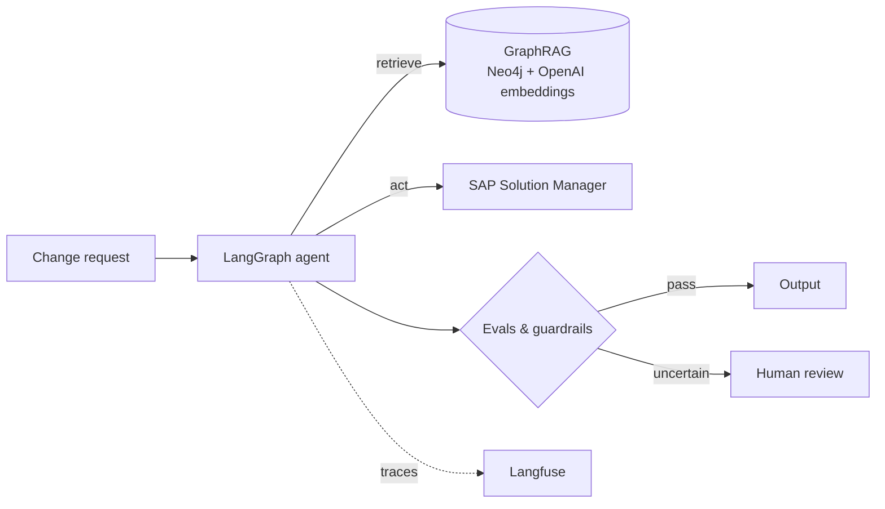

# Hey, I'm Sikandar 👋

**AI Delivery Lead @ AiFA Labs** · IIIT Basar CSE grad · IB CS mentor · Hyderabad 🇮🇳

I started as an engineer and never stopped being one. These days I lead teams building AI agents, 
but I still code most days, because that's how I understand what we're shipping.

---

## ⚡ Daily activity

<picture>
  <source media="(prefers-color-scheme: dark)" srcset="https://streak-stats.demolab.com?user=dearsikandarkhan&theme=dark&hide_border=true&background=0D1117&ring=14B8A6&fire=F59E0B&currStreakLabel=14B8A6">
  
</picture>

  

 

  

<picture>
  <source media="(prefers-color-scheme: dark)" srcset="https://raw.githubusercontent.com/dearsikandarkhan/dearsikandarkhan/output/github-contribution-grid-snake-dark.svg">
  <source media="(prefers-color-scheme: light)" srcset="https://raw.githubusercontent.com/dearsikandarkhan/dearsikandarkhan/output/github-contribution-grid-snake.svg">
  
</picture>

## 🛠️ What I'm building right now

The organisation's first production AI agent. This is roughly how it's put together:

Runs on AWS Bedrock AgentCore. It automates SAP Change Request / Change Order processing, cutting each request from about 10 hours to about 3.

**On my own time:**

- 🔍 **[ai-readiness-lint](https://github.com/dearsikandarkhan/ai-readiness-lint)** is a Node.js CLI that statically checks an AI agent repo for production readiness: evals, guardrails, HITL, observability, cost limits and more. It scores 0–100, runs in CI, and emits a badge.
- 🎙️ **Voice agents on a Raspberry Pi**: real-time speech in, agent reply out, on hardware that fits in a palm.
- 📦 **NPM packages** for CSRF prevention and dependency analysis, plus an open-source resume platform.

## 🧭 Recent work

| Years | Role | What I built |
|---|---|---|
| 2026 – now | AI Delivery Lead · **AiFA Labs** | Production agentic AI: GraphRAG, LangGraph, Langfuse, Bedrock AgentCore |
| 2022 – 26 | Technical Manager · **DocOnline Health** | Mental-health app (35+ features), Stepathon for 20K+ users, SonarCloud + VAPT + ISO 27001-aligned security |

## 🧰 Toolbox

**AI / Agents** &nbsp;

**Code** &nbsp;

**Infra** &nbsp;

## 🎓 Teaching

<table>
<tr>
<td width="65%" valign="top">

I've mentored **IB Computer Science** students since 2017, across both HL and SL.

- Core theory and programming in **Python & Java**
- **Internal Assessment**: picking a real client, then designing, building and testing the project
- **Extended Essay**: research questions, methodology, structure

Eleven years of building real software is what I bring to the classroom. Students see what good code looks like in practice, not just in the textbook. The IA and EE always remain the student's own work.

I also mentor student teams at **Smart India Hackathon**.

</td>
<td width="35%" align="center" valign="middle">

Syllabus map · IA kit · key definitions · study materials

</td>
</tr>
</table>

## ✍️ Latest on Medium

<!-- BLOG-POST-LIST:START -->
<!-- BLOG-POST-LIST:END -->

## 🏅 Bits & badges

- 🥇 1st Prize, Smart Health IoT track, **Asia-Pacific Hackathon 2018** (New Zealand)
- 🏆 **Capgemini Innovative Startup Award**
- ☁️ Google Cloud Architect, Kubernetes Engine Specialization · 🧩 CSM · CSPO
- 🎓 **B.Tech, Computer Science & Engineering — IIIT Basar (RGUKT)**, graduated 2014
- 📘 Executive education in Product Management, **ISB** (2024)

Usually found somewhere between a LangGraph trace and a Raspberry Pi.

