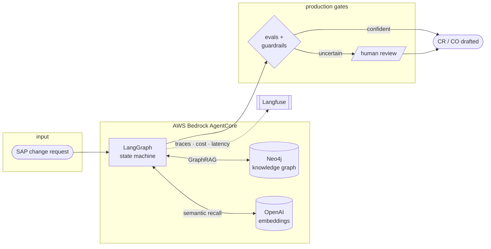
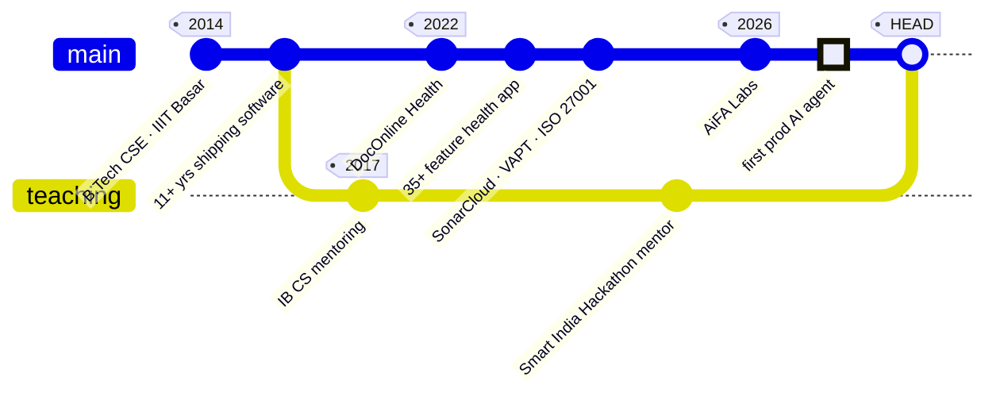
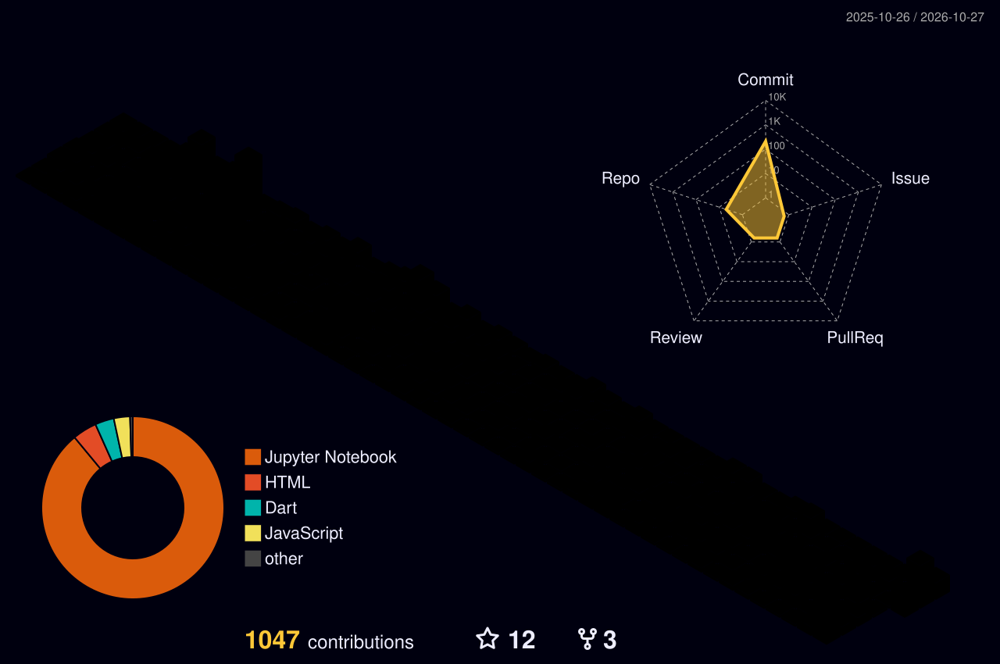

<!-- 👋 Reading the source? Same person, fewer emojis. Say hi on LinkedIn. -->

<div align="center">


<a href="https://linkedin.com/in/dearsikandarkhan"></a>
<a href="https://dearsikandarkhan.medium.com/"></a>
<a href="https://ibcswithsikandar.netlify.app/"></a>
<a href="https://dearsikandarkhan.github.io/"></a>


</div>

```yaml
# sikandar.yaml  ·  kubectl apply -f sikandar.yaml
apiVersion: humans/v1
kind: Engineer
metadata:
  name: sikandar-khan
  region: ap-south-2            # Hyderabad, India
  labels:
    role: technical-program-manager
    focus: agentic-ai
    mode: hands-on               # never left the codebase
spec:
  compiledAt: IIIT-Basar         # B.Tech CSE, class of 2014
  current:
    org: AiFA Labs
    building: production AI agents (GraphRAG · LangGraph · Bedrock AgentCore)
  runtimes: [python, node, typescript, java, dart]
  sideProcesses:
    - ai-readiness-lint          # OSS
    - pi-voice-agent             # Raspberry Pi
    - ib-cs-mentoring            # since 2017
  restartPolicy: Always
```

## `$ top` — what's running

```text
  PID  PROCESS                 STATE      STACK
  001  prod-agent@aifa         ● running   LangGraph · Neo4j GraphRAG · Langfuse · Bedrock AgentCore
  002  ai-readiness-lint       ● running   Node.js CLI · CI gate · SVG badge
  003  pi-voice-agent          ◐ building  Raspberry Pi · speech in → agent → speech out
  004  ib-cs-mentoring         ⏱ cron      Python · Java · IA · EE      (weekly, since 2017)
```

## `$ cat ARCHITECTURE.md` — the agent I'm shipping



> **Result:** SAP Solution Manager CR/CO processing went from **~10 h → ~3 h** per request. It's the organisation's first production AI agent.

## `$ ls ~/oss`

```text
ai-readiness-lint/   static linter for AI-agent repos
│                    repo ──▶ 8 governance checks ──▶ score 0–100 ──▶ CI gate + badge
│                    evals · guardrails · HITL · observability · cost limits · …
npm-packages/        CSRF prevention · dependency analysis
resume-platform/     open-source resume builder
```

👉 [**ai-readiness-lint**](https://github.com/dearsikandarkhan/ai-readiness-lint): because "is this agent ready for prod?" deserves an answer you can run in CI.

## `$ git log --graph --oneline career`



## `$ cat /proc/toolchain`

<p align="center">
  
</p>

<p align="center">
  
  
  
  
  
  
  
</p>

## `$ git shortlog -s --since=today` — daily commits

<div align="center">



<picture>
  <source media="(prefers-color-scheme: dark)" srcset="https://streak-stats.demolab.com?user=dearsikandarkhan&theme=dark&hide_border=true&background=0D1117&ring=14B8A6&fire=F59E0B&currStreakLabel=14B8A6">
  
</picture>


<picture>
  <source media="(prefers-color-scheme: dark)" srcset="https://raw.githubusercontent.com/dearsikandarkhan/dearsikandarkhan/output/github-contribution-grid-snake-dark.svg">
  <source media="(prefers-color-scheme: light)" srcset="https://raw.githubusercontent.com/dearsikandarkhan/dearsikandarkhan/output/github-contribution-grid-snake.svg">
  
</picture>

</div>

## `$ man ibcs` — teaching

```python
class IBComputerScience(Mentor):
    """Turning abstract CS into things students can explain, build and defend."""

    since     = 2017
    levels    = ("HL", "SL")
    languages = ("Python", "Java")
    covers    = ["core theory", "Internal Assessment", "Extended Essay", "exam prep"]
    edge      = "11+ years of production code: students see what good code looks like in practice"
    invariant = "the IA and EE are always the student's own work"
```

📚 **[ibcswithsikandar.netlify.app](https://ibcswithsikandar.netlify.app/)**: syllabus map, IA survival kit, key definitions and study materials.

## `$ tail -f medium.log`

<!-- BLOG-POST-LIST:START -->
<!-- BLOG-POST-LIST:END -->

## `$ cat achievements.log`

```diff
+ [2018] 1st prize · Smart Health IoT · Asia-Pacific Hackathon, New Zealand
+ [----] Capgemini Innovative Startup Award
+ [2024] Google Cloud Architect · Kubernetes Engine Specialization
+ [2024] CSM · CSPO · Scrum Alliance
+ [2024] Executive education, Product Management · ISB
```

<div align="center">

```console
$ exit 0   # see you in the commit history
```

</div>
